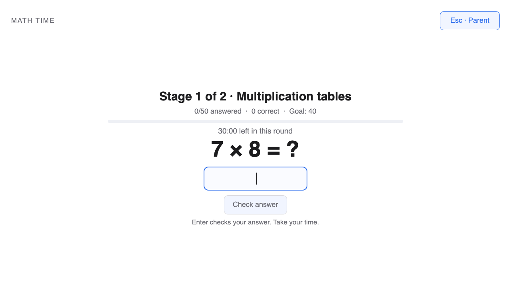
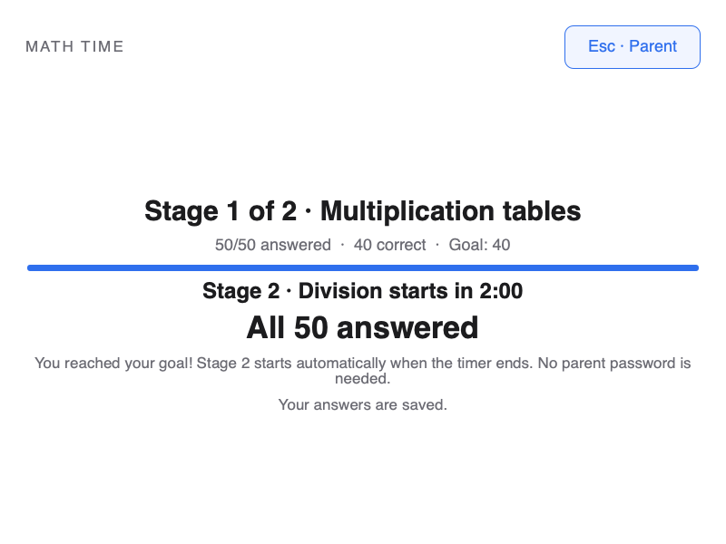
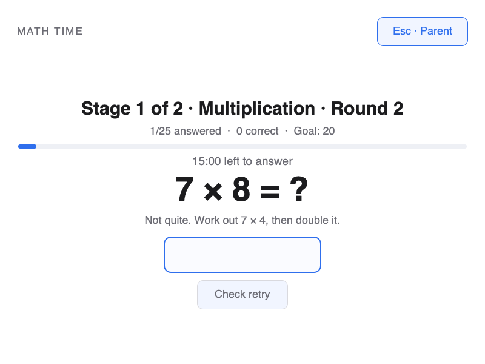
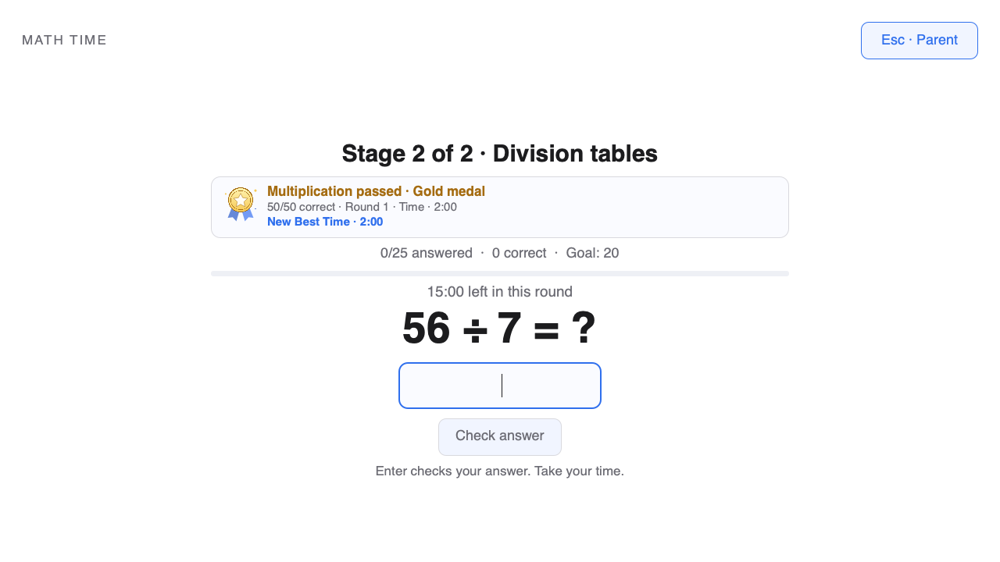
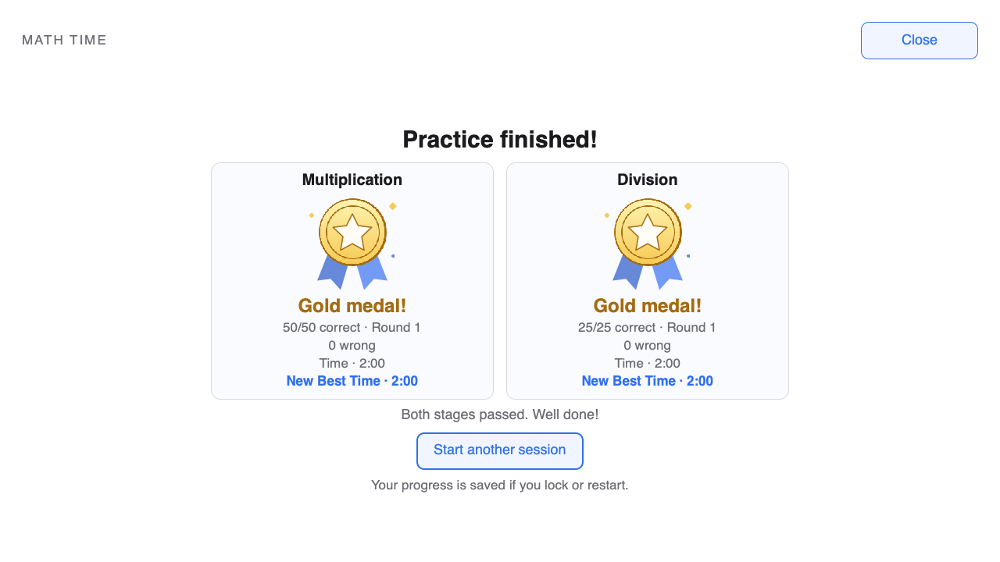

# Math Time

A manually started, full-screen tables app with two stages: **multiplication, then division**. Start with **50 multiplication questions in 30 minutes, with 40 correct to pass**, then complete **25 division questions in 15 minutes, with 20 correct to pass**. A failed round repeats its own stage with 25 questions over 15 minutes until at least 20 are correct. Passing both stages on the first round takes **45 minutes**. Math Time has its own questions, timer, saved progress and parent-password override. It neither requires Screen Time nor earns, spends or changes screen-time minutes.

Works on regular **Omarchy Quattro with the Quickshell plugin system**. Plugin ID: **`io.github.peterholko.math`**. Practice starts manually in both **School Mode and Free Time**. Version **1.6** adds the division stage and preserves separate gold, silver and bronze medals for each stage.

Version **1.6.1** makes the Stage 2 countdown explicit and prevents Space after the last answer from accidentally opening the parent override.



## How practice works

| Stage / round | Time | Questions | Correct answers needed |
| --- | --- | --- | --- |
| Stage 1: multiplication, first round | 30 minutes | 50 | At least 40 |
| Multiplication follow-up, if needed | 15 minutes | 25 | At least 20 |
| Stage 2: division, first round | 15 minutes | 25 | At least 20 |
| Division follow-up, if needed | 15 minutes | 25 | At least 20 |

- Multiplication tables **1–12**, followed by exact division facts from the same tables: for example, **56 ÷ 7**, **72 ÷ 8**, and **144 ÷ 12**. Divisors and answers range from 1 to 12; there are no remainders or division by zero. Each stage shuffles its own 144-fact deck, and every fact appears before that stage's deck repeats, including across follow-up rounds.
- Each question is scored on its **first valid answer**. A correct answer advances. An incorrect answer stays on screen with a strategy hint and **one unscored retry**.
- If the retry is correct, the app confirms it and advances. If it is still incorrect, the app shows the correct equation and waits for **Continue** (or Enter). The original score stays unchanged in either case; retries are part of the same question and do not use another slot in the 50- or 25-question quota.
- Each round lasts its full time. After the question quota and any final retry/review are finished, the score stays visible until the timer ends; the app does not ask more questions in that round. Unanswered questions count as incorrect at the deadline.
- The timer keeps running during hints and answer review. At the deadline, passing multiplication moves directly into division and keeps the practice screen open. Passing division finishes the session. A failed round starts another 15-minute, 25-question round of the same operation. Its score starts at zero and needs 20 correct; this repeats until that stage passes. A failed division round never sends the child back to multiplication.
- **Every new session starts manually.** Booting, logging in, unlocking, changing the date or returning to Free Time never opens Math Time or starts a session. Open the app and choose Start when it is time to practise.
- After passing or a parent ending a session, open Math Time and choose **Start another session** to begin a fresh round, including on the same day. The previous result never blocks a new manual start.
- Time counts while the practice screen is present on the active, unlocked desktop, in either School Mode or Free Time. Leaving every question unanswered can never pass a round. Parent-password entry, locking, suspending and closing the shell pause the clock.
- Root-owned progress preserves the current stage, round, question, retry/review step, score, earned stage rewards and remaining time across logout or reboot. Open Math Time again to resume unfinished work. Offline time does not count, and crossing midnight does not reset a round.
- Escape and the close action open a **parent-password prompt** during required practice. The laptop’s parent/root password can end the session early, including a follow-up; checking and failure feedback are visible. There is no separate PIN or Screen Time account.
- Practice can start and continue in **School Mode or Free Time**. Changing modes preserves the current question, score and timer. An unavailable status for a known school enrollment pauses practice until its status is available again. Installing School Mode is optional.

### Moving from multiplication to division

Finishing all 50 multiplication questions does not skip the remaining time. With at least 40 correct, the screen shows **“Stage 2 · Division starts in …”** and moves into division automatically when the full 30-minute round ends. No parent password or button press is needed. Multiplication follow-ups use the same transition after their 15-minute timer ends.

The parent-password screen is only for ending practice early, and its timer is paused. If you opened it while waiting for division, choose **Back to practice** or press Escape to return and resume the countdown. Entering the parent password ends the session instead of advancing to division.



### Example of a guided retry

For **7 × 8**, an incorrect first answer gets the hint **“Work out 7 × 4, then double it.”** The answer remains hidden while the child tries once more. If that retry is also incorrect, the app reveals **7 × 8 = 56** and waits for Continue. Only the first answer contributes to the round’s passing score.



For **56 ÷ 7**, an incorrect first answer gets **“Think: 7 × what number makes 56?”** The answer stays hidden for one unscored retry, then the app reveals **56 ÷ 7 = 8** if needed. Division uses the same first-answer scoring and Continue behavior.



### Round medals

Each stage awards its own medal when a passing round's full timer finishes:

| Medal | Wrong questions | First multiplication round | Division or a follow-up round |
| --- | --- | --- | --- |
| Gold | 0 | 50/50 correct | 25/25 correct |
| Silver | 1 | 49/50 correct | 24/25 correct |
| Bronze | 2 | 48/50 correct | 23/25 correct |

Medals use the round's first-answer score. A wrong first answer still counts as one wrong question after a retry, even if the retry is also wrong. Unanswered questions count as wrong at the deadline. A score with three or more wrong questions can still pass under the existing 40/50 or 20/25 rule, without a medal. Each follow-up round earns its own result; mistakes from the previous round do not lower its medal.

The multiplication score and medal stay visible during division. The final screen shows both stage results, and division mistakes cannot lower the multiplication medal. Ending early with the parent password awards nothing for the unfinished stage; any already completed stage keeps its reward. Stage results remain saved across closing the app, logout and reboot, until a new session starts. Existing saved first-answer results gain the matching medal after upgrading. Medals are visual rewards and do not change screen time or round durations.



The overlay covers every connected display and takes keyboard focus. This is a practice requirement within an enabled Omarchy shell plugin, not an OS security boundary: someone with administrator access or permission to disable the plugin can bypass its display. Do not remove the parent’s administrative access.

## Install

Run from the intended user's Omarchy desktop terminal. Replace `CHILD_USERNAME` with that account's Linux username in the install, update and removal commands. Only the explicit service setup uses `sudo`; it installs this plugin's local service and enrolls the named account.

```bash
omarchy pkg add python &&
omarchy plugin add https://github.com/peterholko/omarchy-math-time --yes &&
sudo "$HOME/.config/omarchy/plugins/io.github.peterholko.math/setup" --user CHILD_USERNAME &&
mkdir -p "$HOME/.local/share/applications" &&
install -m 644 \
  "$HOME/.config/omarchy/plugins/io.github.peterholko.math/io.github.peterholko.math.desktop" \
  "$HOME/.local/share/applications/io.github.peterholko.math.desktop" &&
omarchy plugin enable io.github.peterholko.math
```

After installation, open **Math Time** from the app launcher and choose **Start 50-question round** in School Mode or Free Time. Enabling the plugin does not open the app or begin practice. No logout or supplementary-group refresh is needed. If Math Time is already installed, use the update instructions below.

The parent override authenticates the existing root password through PAM. On a standard installation without a usable root password, an administrator should set the parent/root password with `sudo passwd root` before enrolling the child. Setup never changes any system password.

### App launcher

The install and update commands add Math Time to the app launcher. If it was installed using the earlier instructions, add its entry from the desktop account:

```bash
mkdir -p "$HOME/.local/share/applications"
install -m 644 \
  "$HOME/.config/omarchy/plugins/io.github.peterholko.math/io.github.peterholko.math.desktop" \
  "$HOME/.local/share/applications/io.github.peterholko.math.desktop"
```

The unique launcher ID does not replace the built-in `omarchy.math` plugin. With the separate [School / Free Time plugin](https://github.com/peterholko/omarchy-school-mode), version 1.1.2 or later allows Math Time in Free Time's launcher. If that plugin is installed, update its approved-app list and restart the shell:

```bash
omarchy plugin update io.github.peterholko.school-mode --yes &&
omarchy restart shell
```

The default School Mode app list includes `io.github.peterholko.math`; a customized school app list must also include that ID to show it in the launcher. The launcher opens Math Time's own practice screen in either mode; an unfinished session resumes when you open it again. Updating Math Time does not change school app approvals.

Open it directly with:

```bash
omarchy-shell shell summon io.github.peterholko.math '{}'
```

### Start or resume a session

Open **Math Time** from the launcher, or use the command above. Choose **Start 50-question round** for a new session or **Start another session** after a previous result. If a session is unfinished, reopening the app resumes it without resetting its score or timer. Once started, it must be completed or ended with the parent password before returning to the desktop normally.

All new sessions start with the 30-minute multiplication round, followed by the 15-minute division stage, with 15-minute follow-ups wherever needed. There is no child-facing stage picker or skip action. Daily and login/unlock triggers have been removed; `setup --trigger manual` remains accepted for compatibility with earlier installation commands.

## Update

Update both the shell plugin and its installed service. Version 1.6 requires the updated service; an older service produces an upgrade message until setup is rerun. Sessions still start manually in either mode. Existing version 1.1–1.5 unfinished multiplication questions, scores and remaining time are preserved, and division follows when that stage passes. Already completed or parent-ended sessions stay finished: upgrading does not start division automatically or invent a division reward. Choose **Start another session** for the new two-stage flow. An unfinished version 1.0 session starts a fresh 50-question round because the old timer did not record first-answer scores. This also upgrades the earlier 0.2 plugin.

```bash
omarchy plugin update io.github.peterholko.math --yes &&
sudo "$HOME/.config/omarchy/plugins/io.github.peterholko.math/setup" --user CHILD_USERNAME --upgrade &&
mkdir -p "$HOME/.local/share/applications" &&
install -m 644 \
  "$HOME/.config/omarchy/plugins/io.github.peterholko.math/io.github.peterholko.math.desktop" \
  "$HOME/.local/share/applications/io.github.peterholko.math.desktop" &&
omarchy plugin enable io.github.peterholko.math &&
omarchy restart shell
```

Setup refuses to overwrite untracked or locally modified system files. It does not alter the Screen Time, School Mode, games or Omarchy Kids services.

## Service and troubleshooting

The service uses Python 3’s standard library, systemd/logind and the system PAM library. The UI uses the Quickshell/Qt Quick runtime supplied by Omarchy; PySide6 is only needed for development tests.

- Service: `peterholko-math-time.service`.
- Root-owned settings: `/etc/peterholko-math-time/config.json`.
- Root-owned progress: `/var/lib/peterholko-math-time/practice.json`.
- Local socket: `/run/peterholko-math-time/sock`. Linux peer credentials restrict each account to its own enrollment. Parent authorization is verified separately through PAM.
- Passwords travel over the local socket/stdin, never command arguments, environment variables or saved practice data.

Check from the enrolled account:

```bash
omarchy-math-time-client status
systemctl status peterholko-math-time.service --no-pager
sudo journalctl -u peterholko-math-time.service -b --no-pager -n 40
```

If the app reports that the account is not enrolled, rerun setup with its actual username. If an active session loses the service connection, the view retains the requirement and reconnects automatically. Restarting the service or shell does not reset saved progress; launch Math Time again to resume. A previous parent-ended result can be followed by **Start another session**, without editing or deleting saved state.

## Remove

An administrator can disable the shell plugin before removing its service enrollment. With other enrolled users, their service remains installed. With the last enrollment removed, setup removes only this plugin’s tracked service files; practice history is retained.

```bash
omarchy plugin disable io.github.peterholko.math
sudo "$HOME/.config/omarchy/plugins/io.github.peterholko.math/setup" --user CHILD_USERNAME --remove
rm -f "$HOME/.local/share/applications/io.github.peterholko.math.desktop"
omarchy plugin remove io.github.peterholko.math
```

## Development and validation

Run local tests in a Python environment with PySide6:

```bash
python3 -m unittest discover -s tests -v
python3 tests/capture_ui.py /tmp/math-time-previews
omarchy plugin validate .
```

Tests cover the 40/50 and 20/25 thresholds, the multiplication-to-division transition, full round durations, repeated follow-ups in each stage, unanswered questions, deadline boundaries, all 144 facts for each operation, guided retries, answer acknowledgement, first-answer scoring, independent stage medals and persistence, parent overrides, incorrect/replayed answers, pause/resume, reboot and upgrades from earlier releases, scheduling, School Mode, parent authentication decisions, the Unix-socket client, and the actual QML controller/service. The portable UI tests replace only the Quickshell process/display adapters; inspect the resulting screenshots as well. Linux PAM, systemd installation and compositor focus still need a smoke test on an Omarchy laptop. No GitHub Actions or paid CI is used.

## License

MIT. See [LICENSE](LICENSE), [ATTRIBUTION.md](ATTRIBUTION.md) and [SOURCE.json](SOURCE.json) for retained notices and source provenance.
